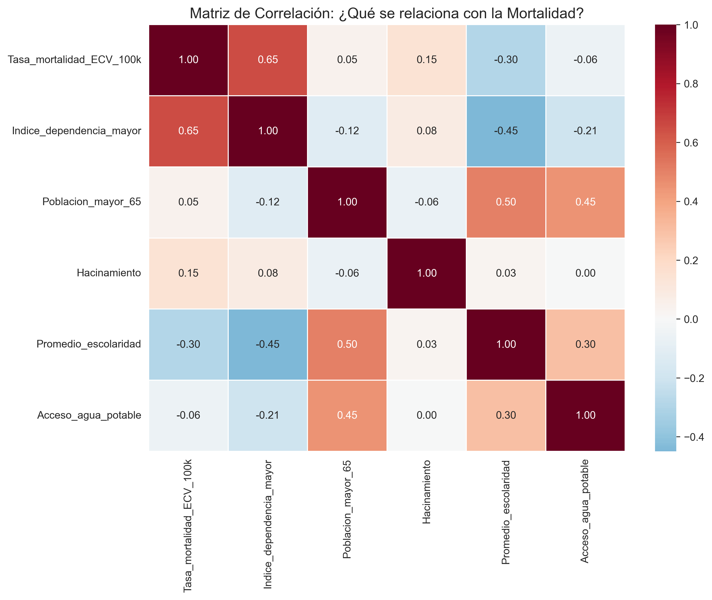
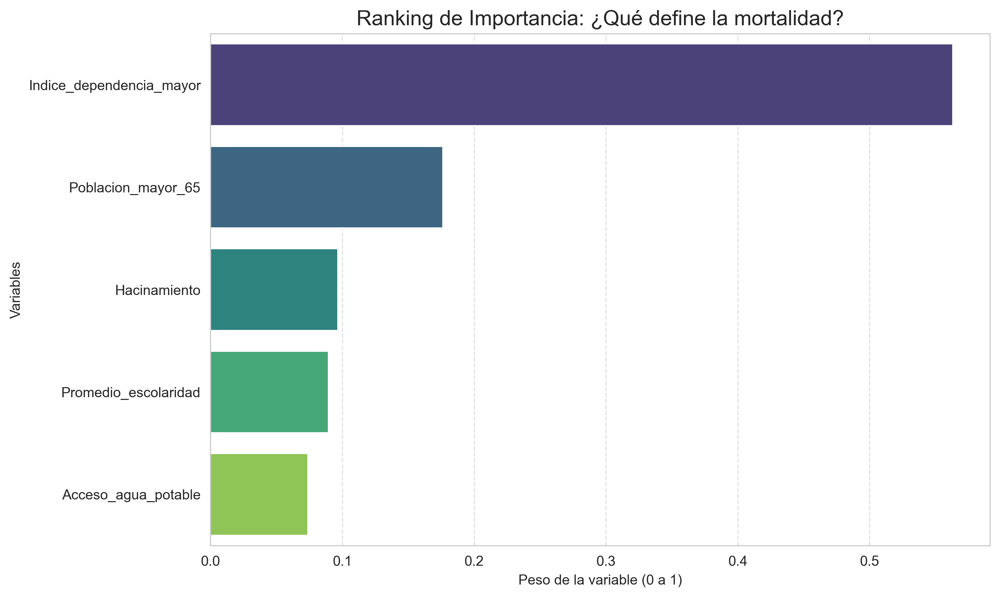

# Análisis Predictivo: Determinantes Socioeconómicos y Mortalidad Cardiovascular a Nivel Comunal en Chile

[](https://www.python.org/)
[](LICENSE)
[](https://pandas.pydata.org/)
[](https://scikit-learn.org/)
[](https://xgboost.readthedocs.io/)

Este proyecto analiza y modela la relación empírica entre las condiciones socioeconómicas estructurales y la tasa bruta de mortalidad por **Enfermedades Cardiovasculares (ECV)** a nivel comunal en Chile, integrando microdatos del **Censo de Población y Vivienda (INE)** con registros oficiales de defunciones del **Departamento de Estadísticas e Información de Salud (DEIS - MINSAL)**.

---

## Contexto y Motivación

Las enfermedades cardiovasculares representan la principal causa de muerte en Chile y en gran parte del mundo. Sin embargo, su impacto no se distribuye de manera homogénea a lo largo del territorio nacional: existen marcadas disparidades entre comunas con distintos niveles de envejecimiento demográfico, años de escolaridad y acceso a servicios básicos.

El objetivo de esta investigación es construir un pipeline de datos reproducible que permita:
1. Consolidar indicadores sociodemográficos y habitacionales a nivel comunal (346 comunas).
2. Estimar la tasa bruta de mortalidad por ECV por cada 100.000 habitantes.
3. Evaluar el poder predictivo de modelos lineales y de ensamble (*Random Forest*, *XGBoost*).
4. Cuantificar la importancia relativa de cada determinante mediante técnicas de explicabilidad (SHAP y permutación).

---

## Fuentes de Datos

| Fuente | Dimensión | Variables Extraídas |
|---|---|---|
| **INE - Censo 2017 (Tabla 1.2)** | Demografía y Dependencia | Población total, población mayor a 65 años, índice de dependencia demográfica del adulto mayor. |
| **INE - Censo 2017 (Tabla 4.2)** | Capital Humano | Promedio de años de escolaridad de la población comunal. |
| **INE - Censo 2017 (Tabla 7.3)** | Servicios Básicos | Porcentaje de viviendas con acceso a red pública de agua potable. |
| **INE - Censo 2017 (Tabla 7.5)** | Habitabilidad | Proporción comunal de hogares en condición de hacinamiento. |
| **DEIS - MINSAL (2017)** | Salud / Mortalidad | Total de defunciones registradas con causas asociadas a ECV (códigos CIE-10 seleccionados). |

---

## Definición de Variables

* **Variable Objetivo ($y$):**
  $$\text{Tasa\_mortalidad\_ECV\_100k} = \frac{\text{Defunciones ECV 2017}}{\text{Población Total}} \times 100.000$$
* **Variables Predictoras ($X$):**
  * `Poblacion_mayor_65`: Volumen absoluto de población senescente.
  * `Indice_dependencia_mayor`: Razón de personas $\ge 65$ años sobre la población en edad económicamente activa (15–64 años).
  * `Promedio_escolaridad`: Años promedio de educación formal.
  * `Acceso_agua_potable`: Cobertura de red formal de agua potable.
  * `Hacinamiento`: Grado de saturación habitacional.

---

## Metodología y Modelos Evaluados

El conjunto de datos unificado ($N = 346$ comunas) fue particionado en un 70% de entrenamiento y un 30% de prueba con semilla fija para asegurar reproducibilidad.

Se implementaron y compararon diversas familias de algoritmos:
1. **Regresión Lineal Múltiple:** Modelo base de referencia.
2. **Modelos Regularizados (Ridge y Lasso):** Para evaluar estabilidad ante multicolinealidad.
3. **Random Forest Regressor:** Ensamble de 100 árboles de decisión no paramétricos.
4. **XGBoost Regressor:** Algoritmo de gradient boosting sobre árboles.
5. **K-Nearest Neighbors (KNN) & Support Vector Regressor (SVR):** Modelos no lineales basados en distancias euclidianas y kernel RBF sobre variables estandarizadas.

---

## Resultados Comparativos

Evaluación sobre el conjunto de test independiente (30% de la muestra comunal):

| Modelo | $R^2$ Score | RMSE | MAE |
|---|---|---|---|
| **Random Forest** | **0.4787** | **46.48** | **34.68** |
| **Regresión Lineal** | 0.4492 | 47.78 | 34.94 |
| **Ridge Regression** | 0.4492 | 47.78 | 34.92 |
| **Lasso Regression** | 0.4493 | 47.78 | 34.90 |

### Hallazgos Principales
* El modelo de ensamble **Random Forest** obtuvo el mejor balance de ajuste ($R^2 \approx 0.48$), superando la cota de la regresión lineal tradicional.
* La variable con mayor peso predictivo es el **Índice de Dependencia del Adulto Mayor**, seguido por la **Población mayor a 65 años**, lo cual concuerda con la literatura epidemiológica sobre el envejecimiento demográfico y la carga de enfermedades crónicas no transmisibles.
* Las variables sociodemográficas (escolaridad y vivienda) aportan efectos moduladores significativos en los extremos de la distribución socioeconómica.

---

## Evidencia Visual

### Matriz de Correlación
Análisis bivariado de correlación de Pearson entre las variables del estudio y la tasa comunal de mortalidad:



### Importancia de Características (Feature Importance)
Ranking de variables más determinantes obtenido a partir del ensamble Random Forest y valores SHAP:



---

## Estructura del Repositorio

```text
analisis-mortalidad-cardiovascular/
├── main.ipynb                       # Pipeline completo: extracción, limpieza, EDA, modelado y SHAP
├── requirements.txt                 # Dependencias Python reproducibles
├── matriz_correlacion.png           # Mapa de correlaciones de Pearson
├── ranking_importancia.png          # Gráfico de feature importance
├── results/
│   ├── base_comunal_ini.csv         # Consolidado preliminar de fuentes INE
│   └── base_final_con_mortalidad.csv# Base comunal final integrada con defunciones DEIS
├── LICENSE                          # Licencia MIT
└── README.md                        # Documentación técnica del proyecto
```

---

## Instalación y Reproducibilidad

### 1. Clonar el repositorio
```bash
git clone https://github.com/zMatuiti/analisis-mortalidad-cardiovascular.git
cd analisis-mortalidad-cardiovascular
```

### 2. Configurar el entorno virtual
```bash
python -m venv venv

# En Windows:
venv\Scripts\activate

# En Linux / macOS:
source venv/bin/activate
```

### 3. Instalar requerimientos
```bash
pip install --upgrade pip
pip install -r requirements.txt
```

### 4. Ejecutar el Notebook
```bash
jupyter notebook main.ipynb
```

---

## Autor y Licencia

* **Autor:** Matías Tirado López ([@zMatuiti](https://github.com/zMatuiti))
* **Licencia:** Distribuido bajo la [Licencia MIT](LICENSE).
